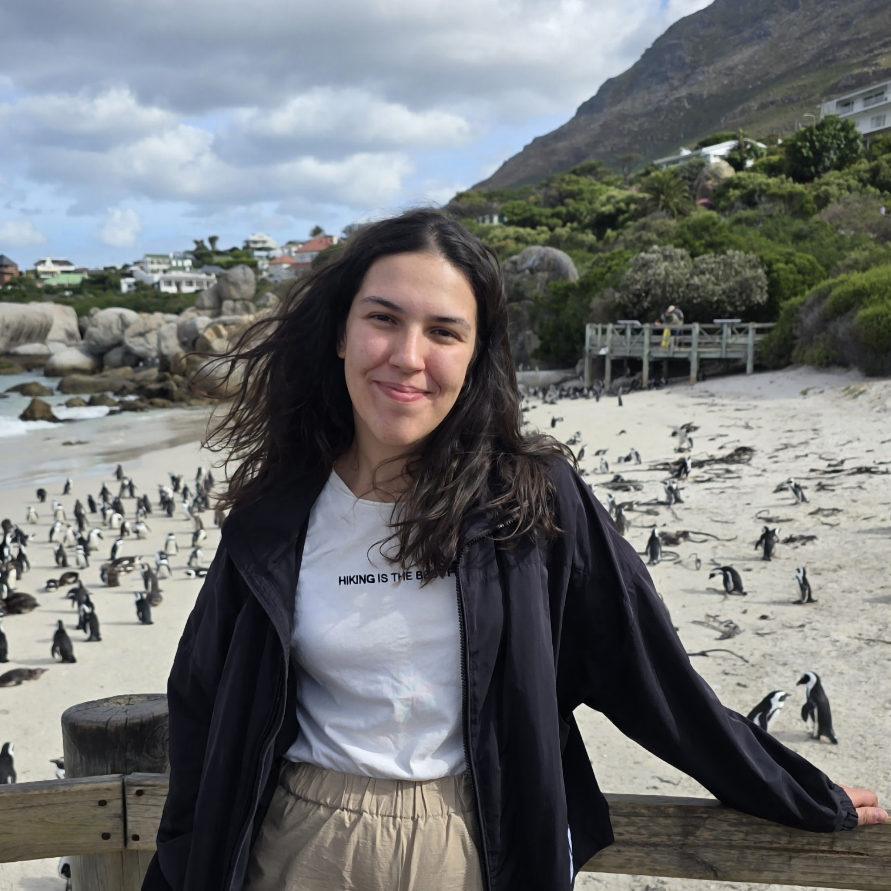

  

    <h2 style="margin-top:0;margin-bottom:0.2em;">Sofia Montebugnoli</h2>
    
Bologna, Italy

    
<a href="mailto:sofia.montebugnoli3@unibo.it">sofia.montebugnoli3@unibo.it</a>

    

      <a href="https://orcid.org/0009-0001-2461-8468">ORCID</a>,
      <a href="https://github.com/sofiamontebugnoli">GitHub</a>,
      <a href="https://www.linkedin.com/in/sofia-montebugnoli-016440284/">LinkedIn</a>
    

    
<strong><a href="/cv.pdf">Download CV (PDF)</a></strong>

  

  

    
  

---

### Short Presentation

I am Sofia Montebugnoli (Graduate Student Member, IEEE; Student Member, ACM), a postdoctoral researcher at the University of Bologna, Italy. I earned my PhD in Computer Science and Engineering there in July 2026 with a dissertation on a cloud-native framework for Open RAN service management and orchestration, which I developed within the PNRR RESTART project in collaboration with Imola Informatica S.p.A. My research covers cloud-native management and orchestration for Open RAN and next-generation mobile networks, including Near-RT RIC platforms, xApp/rApp lifecycle management, and Kubernetes-based orchestration. In 2025 I spent six months as a visiting researcher in Prof. Tommaso Melodia's group at Northeastern University.

I chair the IEEE ComSoc Student Branch Chapter at the University of Bologna and sit on the IEEE ComSoc Young Professionals Webinar Team. From 2024 to 2026 I was Student Member Representative on the IEEE ComSoc EMEA Board. I also work as ICT Research Consultant at Imola Informatica S.p.A. and tutor two university courses.

---

### Research Area and Expertise

- **Domain Areas:** 5G/6G Networks, Open Radio Access Networks (O-RAN), AI-RAN, Smart Cities, Green IT, Industry 4.0/5.0
- **Technical Expertise:** Cloud Continuum, Service Management and Orchestration (SMO), Near-RT RIC, xApp/rApp Development, MLOps, DevOps for Telecommunications, High Performance Computing, Cloud-Native Architectures

---

### Education

- **PhD in Computer Science and Engineering (XXXVIII Cycle)**, University of Bologna, March 2023 – July 2026
  - Thesis: "A Cloud Native Solution for Service Management and Orchestration in Next Generation Networks"
  - Final grade: Excellent (defended on July 10, 2026)
  - Supervisors: Prof. Luca Foschini, Prof. Paolo Bellavista — [Mobile Middleware Research Group](https://site.unibo.it/middleware/en)
- **PhD Visiting Research Period**, Northeastern University, Boston, MA, USA, April 2025 – September 2025
  - Institute for the Wireless Internet of Things, [WINES Lab](https://wineslab.github.io/) led by Prof. Tommaso Melodia
  - Cloud-native deployment and automation of Open RAN systems
- **Master's Degree in Computer Engineering**, University of Bologna, September 2020 – December 2022
  - Final grade: 110/110 cum laude
  - Thesis: "Energy consumption of parallel linear systems solver algorithms on HPC architecture" (Supervisors: Prof. Anna Ciampolini, Prof. Daniela Loreti)
- **Advanced Training Course in Industry 4.0**, University of Bologna, 2022
- **Bachelor's Degree in Computer Engineering**, University of Bologna, September 2017 – October 2020
  - Thesis: "Progetto e implementazione dell'interfaccia utente per la piattaforma tuProlog"
- **High School Diploma in Applied Sciences**, Francesco Alberghetti Institute, Imola, 2012 – 2017

---

### Professional Experience

- **Postdoctoral Researcher**, University of Bologna (March 2026 – present)
  - Cloud-native management and orchestration for Open RAN, AI-RAN, and next-generation mobile networks
  - Kubernetes-based orchestration frameworks, service mesh integrations, and intent-driven automation
  - Scalable resource management for disaggregated 5G/6G RAN infrastructures
  - Leading system integration, validation, and performance evaluation with academic and industrial partners
- **Visiting Researcher**, Northeastern University – WINES Lab, Boston (April 2025 – September 2025)
  - Designed and developed MANATEE, a DevOps platform for the full lifecycle management of Open RAN xApps (build, deployment, automated testing against real and emulated RAN environments)
  - Contributed to AutoRAN (NTIA Public Wireless Supply Chain Innovation Fund) on zero-touch integration, deployment, and continuous testing of multi-vendor cellular stacks
- **Teaching Assistant – Distributed Systems M** (Master's course), University of Bologna (September 2023 – present)
  - Practical exercises on DevOps, Jakarta EE, WildFly, Docker, Spring, Spring Boot, and Kubernetes; 30 hours per academic year
- **Teaching Assistant – Computer Networks T** (Bachelor's course), University of Bologna (September 2025 – present)
  - Academic tutor for the course taught by Prof. Antonio Corradi, Prof. Armir Bujari, and Prof. Andrea Sabbioni; 30 hours for 2025/26
- **ICT Research Consultant – ImolaLab R&D**, Imola Informatica S.p.A. (November 2023 – present)
  - Technology transfer between academia and industry; assistance for Bachelor and Master thesis internships; evaluation of cloud products and emerging technologies
- **Engineering Lecturer – Front-End Web Technologies**, ECIPAR Regionale for CNA, Bologna (February 2023 – June 2023)
  - 60 hours of lectures on HTML, CSS, JavaScript, and React to high-school graduates
- **Research Assistant**, University of Bologna / Injenia S.r.l. (January 2023 – February 2023)
  - Multicloud observability with Terraform, Kubernetes, and ElasticSearch
- **Marketing Assistant**, Officine Volta S.p.A. (2016, 2018) – price list redesign with Adobe InDesign, Illustrator, Photoshop, and Excel
- **ICT System Administrator Intern**, Emerson Network Power (2015) – Ubuntu setup, VPN configuration, cloud maintenance

---

### Academic Third Mission

- **Member, Young Professionals Webinar Team**, IEEE Communications Society (September 2026 – present)
- **Student Branch Chapter Chair**, IEEE ComSoc, University of Bologna (November 2025 – present)
- **Student Member Representative – EMEA Board**, IEEE ComSoc (May 2024 – April 2026)
- **Social Media Co-Chair and Board Member**, N²Women (February 2025 – February 2026)

---

### Tutorials

- **TUT-01: From Simulation to AI-Native Deployment: Building, Testing, and Operating Open RAN Control Applications** — IEEE CCNC 2027, 9 January 2027. Half-day tutorial; sole in-person presenter, with L. Foschini and P. Bellavista. [Event page](https://ccnc2027.ieee-ccnc.org/events/tut-01-simulation-ai-native-deployment-building-testing-and-operating-open-ran-control)

---

### Publications

16 published or accepted papers and 6 under review. Full list on the [Publications](/publications/) page.

---

### Honors and Awards

- **Best Presentation Award**, [IEEE ComSoc CSIM 6G Industrial Dissemination Day](https://csim.committees.comsoc.org/activities/ieee-csim-idd-event/) (December 2025) – "AI-Enhanced RAN Infrastructure: Dynamic Resource Orchestration for Sustainable 6G Computing"
- **Best Paper Award**, [IEEE ISCC 2023](https://2023.ieee-iscc.org/) – MoCS Workshop (July 2023) – "A Multi-Cloud Observability Support Based on ElasticSearch for Cloud-Native Smart Cities Services"

---

### Research Projects

- **AutoRAN** (Northeastern University, 2025) – NTIA Public Wireless Supply Chain Innovation Fund; cloud-native and infrastructure-as-code components of the automation pipeline
- **[RESTART SUPER Task](https://fondazione-restart.it/projects/s2-super/)** (March 2023 – February 2026) – PNRR National Project; integration of optimization models, virtualization, orchestration, and management in RAN and 5G Core
- **[RESTART Industrial Networks Task](https://fondazione-restart.it/projects/s9-in/)** (March 2023 – February 2026) – PNRR National Project; network architectures and computing infrastructures for Industrial IoT

---

### Thesis Supervision

Co-supervised 4 Master's theses and more than 20 Bachelor's theses and project activities in cloud continuum, observability, orchestration, and 5G networking.

---

### Professional Service

- **Publication Chair**, [European Wireless 2026](https://ew2026.european-wireless.org/#committees), Rimini, Italy
- **Web Co-Chair**, [IEEE ISCC 2026](https://ieee-iscc.computer.org/2026/)
- **Web Co-Chair**, [IEEE CAMAD 2025](https://camad2025.ieee-camad.org/)
- **Web Co-Chair**, [IEEE ISCC 2025](https://ieee-iscc.computer.org/2025/), Bologna, Italy

**Technical Program Committee:** IEEE CCNC 2027 (Track T3), IWNC 2026, IEEE ISCC 2026, MoCS 2026 @ ISCC, IEEE ICC 2026 WS-01 on Open RAN, IEEE ISCC 2025, MoCS 2025 @ ISCC, IEEE WCNC 2025 WS05 on Open RAN

**Peer Review:**
- *Conferences:* IEEE ICC 2025, IEEE WCNC 2025, CNSM 2025, WiMob 2025, IEEE CCNC 2026
- *Journals:* IEEE TGCN, IEEE TNSM, IEEE Networking Letters, IEEE Vehicular Technology Magazine, Elsevier Computer Networks, Elsevier Computer Communications, Elsevier JNCA, Elsevier SUSCOM, Elsevier MethodsX

---

### Skills

- **Infrastructure:** Kubernetes, Docker, OpenStack, Terraform, Helm, Knative, OpenShift, Proxmox, Kafka, RabbitMQ, MQTT, Ceph, ELK, Prometheus, Grafana
- **5G & O-RAN:** Near-RT RIC, Non-RT RIC, SMO, xApp/rApp development, NS3, ns-O-RAN, OpenAirInterface, srsRAN, FlexRIC
- **Service Mesh & Orchestration:** Istio, Istio Ambient Mesh, Linkerd, Cilium, TOSCA, Crossplane
- **DevOps & CI/CD:** Git, GitHub, GitLab, Ansible, ArgoCD, Jenkins
- **Programming:** Python, C/C++, Java, Go, Rust, Bash, SQL
- **Web:** HTML, CSS, JavaScript, React, Node.js, Spring Boot, Jakarta EE, WildFly
- **Databases:** MySQL, MongoDB, ElasticSearch, PostgreSQL, InfluxDB
- **ML & Data:** scikit-learn, Pandas, NumPy, TensorFlow, MLflow, MCP, RAG
- **HPC:** ScaLAPACK, MPI, SLURM

---

### Conference Attendance

IEEE ICC 2026 (Glasgow) · Cloud Native Days Italy 2026 (Bologna) · Open6G + AI Workshop 2026 (Boston) · RESTART Plenary Meetings (Rome 2026, Palermo 2025, Catania 2024) · IEEE ISCC 2025 (Bologna) · IEEE ICC 2025 (Montreal) · IEEE GLOBECOM 2024 (Cape Town) · IEEE HPSR 2024 (Pisa) · Lipari School on Advanced Networking Systems 2024 · IEEE MetroInd4.0&IoT 2024 (Florence) · 5G&Beyond 2024 (Rome) · SC'23 (Denver) · RESTART Tech Camp on 5G and O-RAN 2023 (Rome) · SSIE Summer School 2023 (Bressanone) · IEEE ISCC 2023 (Tunis)

---

### Memberships

IEEE Graduate Student Member (2022 – present) · IEEE ComSoc Student Member (2023 – present) · ACM Student Member (2023 – present) · N²Women Member (2025 – present)

---

### Languages

Italian (native), English (C1, full professional proficiency), Spanish (A1)

---

### I like
🍕 pizza, 🐱 cats, 🏋️ workouts, 🥾 hikes, and 🙈 avoiding big crowds (but I promise I'm friendly!)

_Updated November 2026_
